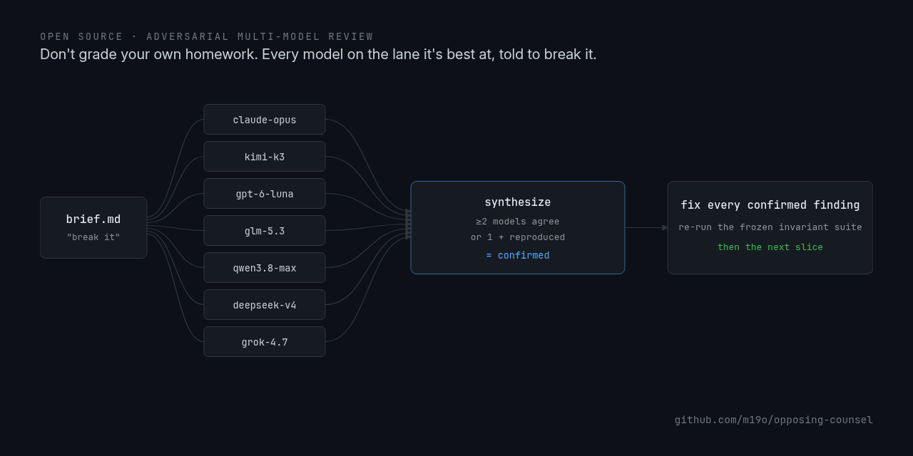
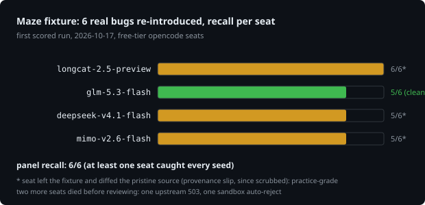
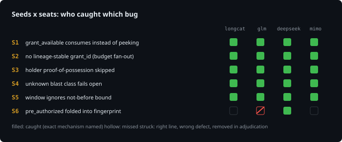

# Opposing Counsel



A panel of models acting as opposing counsel to your approach, your features, and your code before you ship them. Build one slice, hand it to the panel told to break it, fix every confirmed finding, re-run the invariant tests, move on. The artifact under review is whatever a wrong claim about would be expensive: the design of a control, a feature slice, a UI pass, a benchmark's methodology, the code itself. A claim cannot be signed off by its author: the author shares the blind spot that let the bug through, and "the tests pass" only proves the cases you already thought of. The panel is cross-family on purpose: every model sits on the lane it is best at (docs/model-strengths.md), and a claim is never verified by the model that made it. Skip it for low-stakes work; a board costs several model runs per slice. The method is written up in docs/build-judge-fix-panel.md; this repo packages it to run.

## The method

1. Build one slice, small enough to reason about whole.
2. Judge it with a panel of different models, each told explicitly to break it. "Review this" gets you approval; "find where this control lies" gets you findings. At least one reviewer must read the code closely enough to reproduce a failure, not just inspect.
3. Synthesize. A finding two independent models raise is almost certainly real; a lone claim gets verified against the code before you act on it. Votes don't decide; the code does.
4. Fix every confirmed finding.
5. Re-run the frozen invariant suite before the next slice.

Keep the honest caveats the panel surfaces and ship them with the artifact.

## Running a board

Requirements: POSIX sh, ripgrep, xargs with -P, and one provider: `opencode` for `run-board.sh` (a hosted catalog, 100+ models), or the `claude` and `kimi` CLIs for `run-kimi-claude-board.sh` (a two-runtime board on subscriptions you already have). The synthesis tooling (`synthesize.py`) needs python3, stdlib only.

```sh
./run-board.sh <output-dir> <repo-dir> <brief-file> [workers] [model-filter]
./run-kimi-claude-board.sh <output-dir> <repo-dir> <brief-file> [workers] [claude-models] [kimi-models]
```

Both runners validate the brief (present, readable, non-empty) and resolve it to a physical absolute path before any seat starts: seats run against the reviewed repo, so a same-named file inside it can never shadow the brief you passed. Both runners take the same brief and produce the same shape of output: one findings file per seat, plus a `status.tsv` logging each seat's exit code, output bytes, and finish time (run-board.sh keys rows by model, run-kimi-claude-board.sh by runtime/model). The runner exits 1 when the panel is empty (a filter matching zero seats is a failed board, never a silent success), when any seat exits nonzero or returns an empty findings file, or when the output dir fails the safety checks, so automation chained on `$?` never proceeds on a dead board. Output dirs must sit outside the reviewed repo (findings inside it would let seats read each other's work and break panel independence), contain no symlinks, and be either empty or created by the runner (it marks its own with a `.opposing-counsel` token and clears stale findings on rerun, so yesterday's review never leaks into today's synthesis). If the reviewed repo carries agent config (`.claude/`, `opencode.json`, `.kimi*`, `AGENTS.md`), the runner warns: config travels with the repo, see the untrusted-repositories section.

Curate the panel; don't run the whole catalog. Several models from one vendor are one reviewer with extra cost. Assign lanes by strength: the deep reasoner gets architecture and authorization, the careful reader gets evidence and honesty, the coding model gets implementation, and at least one seat comes from a different vendor so one vendor's taste never goes unchecked. The measured lane table, challenged against public benchmarks, is in docs/model-strengths.md. Five to eight seats across families is a good default: `./run-board.sh out/ /path/to/repo brief.md 4 'claude-(opus|sonnet|haiku)|kimi-k3|gpt-6|glm-5|qwen3.8-max|grok-4'`. `run-kimi-claude-board.sh` defaults to `opus,sonnet,haiku` plus `kimi-code/k3`; pass an empty string for either family list to disable it. Claude seats are restricted to read tools at the CLI level (`--allowedTools "Read,Grep,Glob"`); kimi and opencode seats are read-only by instruction only: the prompt forbids edits, writes, network, and credentials. Keep that sentence if you modify the scripts.

Regression tests stub the provider CLIs, so they run offline: `sh tests/brief-path.sh`.

## The brief and the synthesis

A good brief (template in `brief-template.md`) states the exact artifact under review, that the review is read-only, the lanes to cover (authz/scope, subprocess execution, request/transport enforcement, state/replay, concurrency/budgets, evidence, verifier gaming, test gaps), the finding format (severity, file:line, repro, impact, quoted evidence, proposed fix, untested limitations), and the enforcement boundary: which defects belong to this package and which to a shared dependency. Tell reviewers to separate proven defects from hypotheses, and to say so when a lane has nothing.

After the runs, `python3 synthesize.py <output-dir>` merges the seat outputs into `findings.jsonl` and a ranked `summary.md`. Confirmed means raised by two or more independent seats, or raised once and reproduced against the code. Plausible means a lone claim not yet reproduced. Rejected means inspected and found not to hold. The merge is heuristic and the report says so; treat it as the triage queue. Votes don't decide; the code does. Then fix the confirmed set, re-run the invariant suite, and record the per-slice verdicts in your change log, including what shipped as a known caveat.

## The board, measured





Six bugs that once shipped in the Maze authorization pattern were re-introduced into its reference implementation, and four free-tier seats reviewed it blind with this repo's runner and brief. Panel recall 6/6; per-seat 5-6/6 after adjudication. glm-5.3-flash's 5/6 is the clean number: three seats followed a provenance path out of the fixture and diffed the pristine source, so their rows are practice-grade, and two more seats died before reviewing. The fixture, answer key, and scorer stay private (an answer key next to the target ends the game); the graphs are the published result.

## Reviewing untrusted repositories

The panel reads content you may not control, and seat outputs are untrusted content too. A hostile repo can ship agent instructions or CLI hooks (for example `.claude/` settings) that fire when a seat reads it; `--allowedTools` restricts tools, not hooks. A repo can also instruct a seat to read files outside it and quote them, so findings files can contain attacker-influenced or sensitive content. Sandbox the board when the repo is not yours (for example `bwrap` with a read-only bind mount), never publish findings raw, and re-verify every quoted "evidence" snippet against the code yourself.

## Provenance

This workflow built and challenged the gates, capability fixes, budget and verifier slices, UI features, and the eval layer of a private autonomous-security platform, with the frozen invariant suite re-run green after every change. In one session a cross-family panel caught an anonymization leak a single model missed; in another, a different model caught a silently regressed confirm gate. The Maze authorization pattern was hardened under the same loop; the measured benchmark above is built from that hardening history. Don't grade your own homework is the whole point. MIT, see LICENSE.
